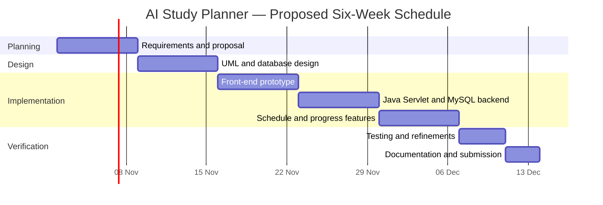
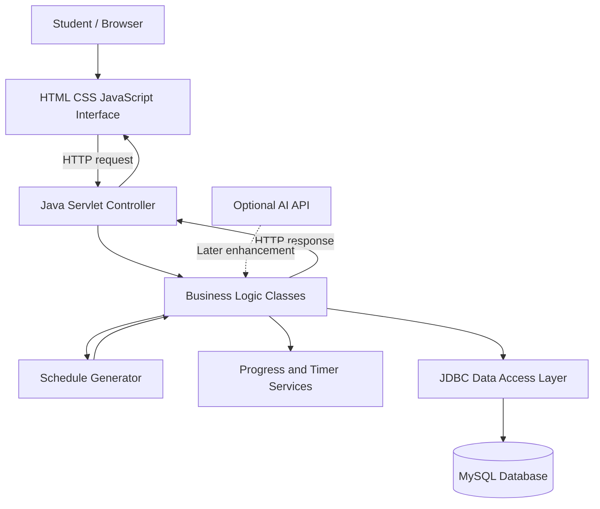
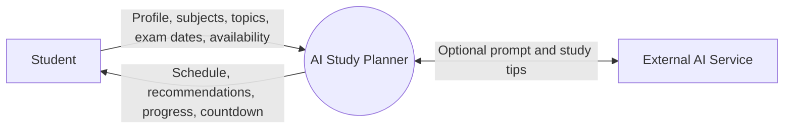
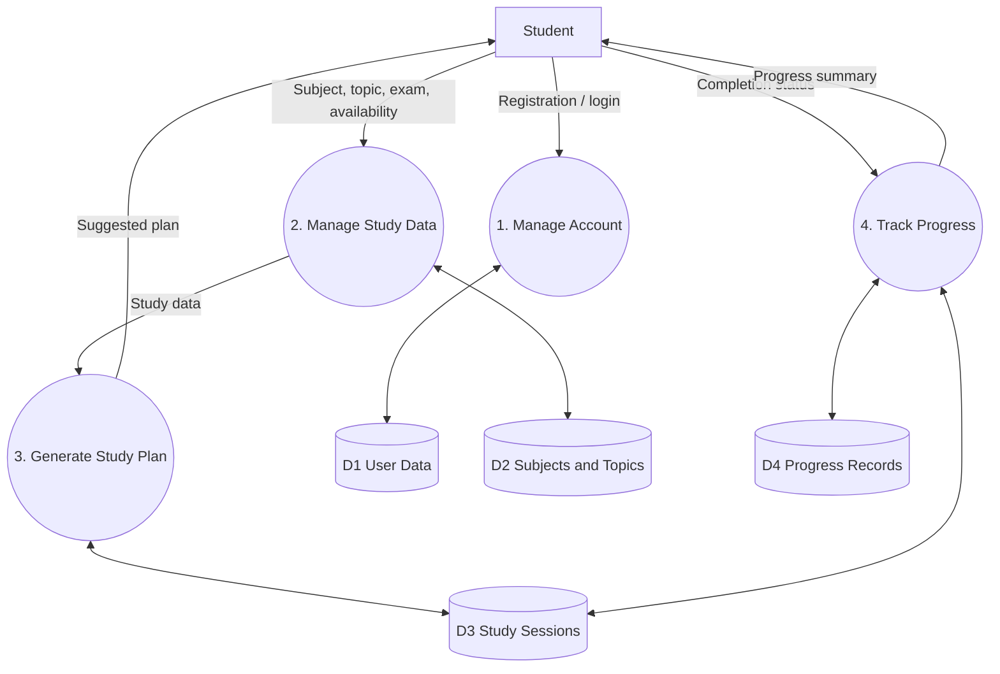
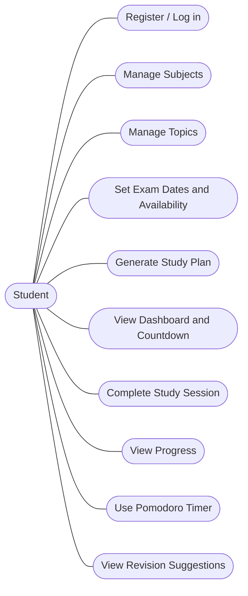
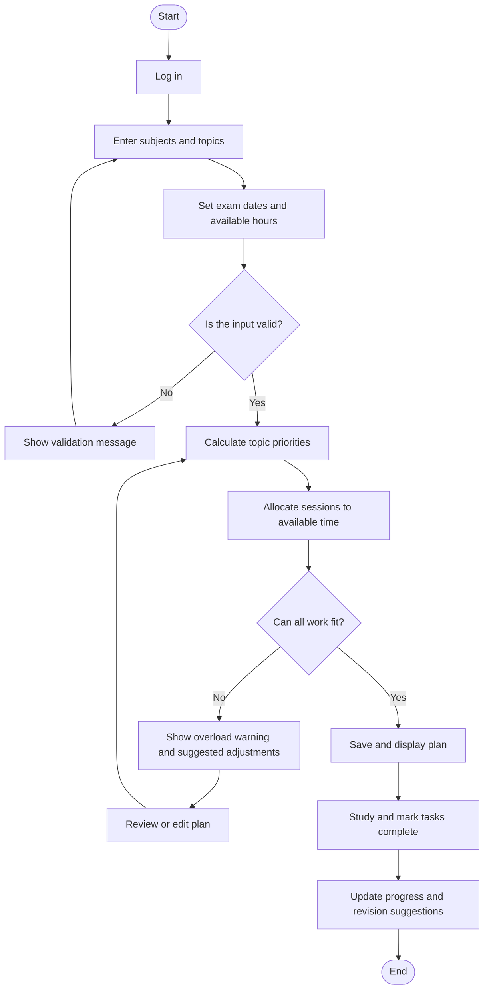
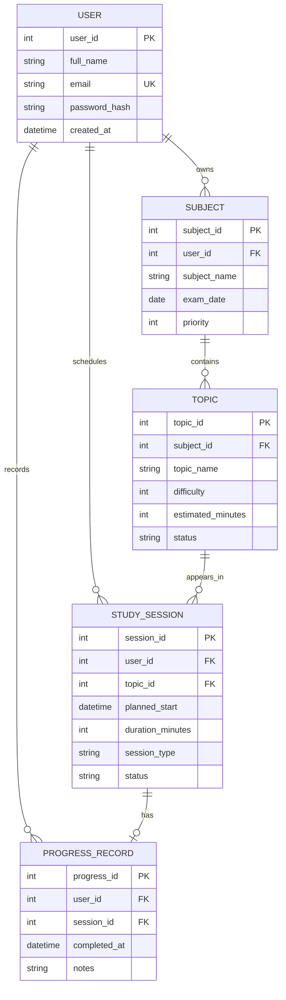
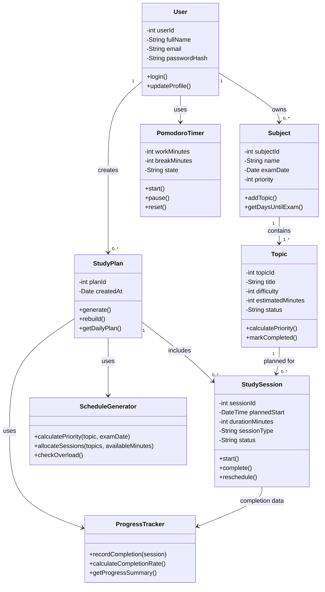
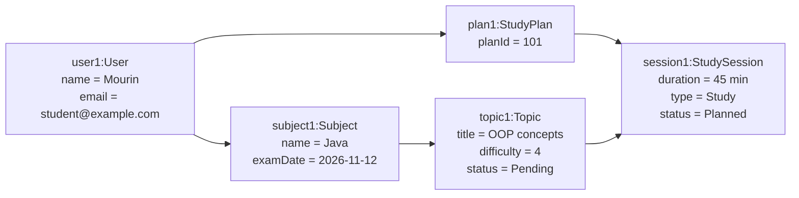

# AI Study Planner
### Final Capstone Project Proposal and Prototype

> **Tagline:** Plan Smarter. Study Better. Achieve More.

**Project type:**Mehejabin Jannat Mourin  
**Student ID:** IT-24062  
**Course:** Software Engineering and Project Management(ICT-31007) 
**Instructor:** Prof.Dr Ziaur Rahman
**Institution:** Mawlana Bhashani Science and Technology
**Proposal date:** 27.10.26 

---

## 1. Executive Summary

AI Study Planner is a web-based study management application designed to help students organize subjects, syllabus topics, exam dates, and available study time in one place. It creates a personalized study schedule, tracks completed tasks, reminds students to revise topics, and provides recommendations based on urgency, difficulty, and progress.

The first version will use a transparent rule-based scheduling engine so that the project can be implemented and tested without depending on a paid AI service. An optional AI API can be integrated later to generate natural-language study tips. The system will use HTML, CSS, and JavaScript for the user interface, Java Servlets for server-side logic, and MySQL for persistent data storage.

The project will follow the **Incremental Software Development Model**. Core functions will be developed in small, testable increments, beginning with the interface and study data, then adding scheduling, progress tracking, and recommendations.

## 2. Introduction and Background

Students often have multiple subjects, different exam dates, large syllabuses, and limited daily study time. When study planning is done manually, students may spend too much time on easy topics, forget revision, or fail to give enough attention to difficult subjects.

AI Study Planner aims to provide a structured and practical way to plan study sessions and monitor progress. The application is intended for individual students and is suitable for a capstone project because it combines user interface design, object-oriented programming, database design, software process planning, and system modelling.

## 3. Problem Statement

Many students organize their study schedules using paper notes, basic calendars, or separate applications. These methods may not consider topic difficulty, time remaining before an exam, estimated topic duration, and completed work together. As a result, study plans can become unrealistic and progress can be difficult to measure.

The proposed system will bring these activities into one application and help students create a manageable, adjustable study plan.

## 4. Project Aim and Objectives

### 4.1 Main Aim

To design and prototype a web-based study planner that helps students create personalized study schedules and track academic preparation.

### 4.2 Specific Objectives

1. Allow students to create an account and manage their profile.
2. Allow students to add subjects, syllabus topics, topic difficulty, and estimated study duration.
3. Store exam dates and daily available study time.
4. Generate a suggested schedule based on urgency, difficulty, and available time.
5. Allow students to mark sessions as completed and view progress.
6. Provide revision suggestions and an exam countdown.
7. Provide a Pomodoro-style study timer.
8. Use a relational database to store users, subjects, topics, sessions, and progress.
9. Build a responsive interface that works on desktop and mobile screens.
10. Document the system with UML and data-flow diagrams and test the main use cases.

## 5. Proposed Solution

The application will ask a student to enter their subjects, topics, exam dates, difficulty levels, estimated topic durations, and available study hours. The scheduling engine will prioritize topics using simple, explainable rules.

For example, a topic may receive higher priority when its exam is closer, its difficulty is high, or it has not yet been completed. The system will then allocate study sessions within the student's available daily time. Students can edit the suggested plan when their circumstances change.

**Example scenario:** A student has Java, Computer Networking, and Microprocessor exams in ten days and can study three hours per day. The student marks Microprocessor as difficult. The planner assigns more time to Microprocessor while reserving time for the other subjects and revision.

## 6. Scope

### 6.1 Included in the Initial Version

- Student registration and login (backend implementation planned)
- Dashboard showing subjects, tasks, and progress
- Subject and topic management
- Exam date and available-time input
- Rule-based study schedule generation
- Daily task completion tracking
- Exam countdown and revision suggestions
- Pomodoro timer
- Responsive web interface
- MySQL database and Java Servlet backend design
- Testing, documentation, and GitHub version control

### 6.2 Outside the Initial Version

- Automatic access to university learning-management systems
- Automatic import of syllabuses from PDFs
- Mobile applications for Android and iOS
- Paid subscription features
- Guaranteed prediction of exam questions or academic results
- Advanced machine-learning model training

An external AI API is an optional enhancement. The core schedule generator will work without it.

## 7. Stakeholders and Users

| Stakeholder | Interest / Responsibility |
|---|---|
| Student | Enters subjects and study availability; follows and updates the plan |
| Project developer | Designs, implements, tests, and documents the system |
| Instructor / evaluator | Reviews proposal, diagrams, implementation, and demonstration |
| Administrator (future extension) | Manages system-level configuration and support |

## 8. Functional Requirements

| ID | Requirement |
|---|---|
| FR-01 | The system shall allow a student to register and log in. |
| FR-02 | The system shall allow a student to create, edit, and delete subjects. |
| FR-03 | The system shall allow topics to be added to each subject. |
| FR-04 | The system shall store exam dates, difficulty levels, and estimated study time. |
| FR-05 | The system shall accept the student's available study time per day. |
| FR-06 | The system shall generate a suggested schedule using priority rules. |
| FR-07 | The system shall allow students to mark study sessions as completed. |
| FR-08 | The system shall display completed and remaining tasks. |
| FR-09 | The system shall display exam countdowns and revision suggestions. |
| FR-10 | The system shall provide a start, pause, and reset study timer. |
| FR-11 | The system shall save student and study-plan data in a database. |
| FR-12 | The system shall validate input and show understandable error messages. |

## 9. Non-Functional Requirements

- **Usability:** Common tasks should be understandable without special training.
- **Performance:** Typical dashboard and schedule operations should respond within a reasonable time under normal student-project testing conditions.
- **Reliability:** Invalid data should not be saved; completed tasks should remain completed after refresh when connected to the backend.
- **Security:** Passwords must be hashed on the server; database credentials and API keys must not be committed to GitHub.
- **Privacy:** Only data needed for planning should be collected.
- **Maintainability:** Code should be separated into presentation, business logic, and data-access layers.
- **Portability:** The front end should work in modern browsers and adapt to different screen sizes.
- **Accessibility:** Use labels, keyboard-operable controls, readable contrast, and meaningful messages.

## 10. Technology Stack

| Technology | Purpose |
|---|---|
| HTML5 | Page structure |
| CSS3 | Responsive layout and visual styling |
| JavaScript | Client-side interactions and prototype schedule logic |
| Java | Object-oriented business logic |
| Java Servlet / JSP | Server-side request handling and web integration |
| MySQL | Persistent relational data storage |
| JDBC | Communication between Java and MySQL |
| Git and GitHub | Version control, source hosting, and submission |
| Optional AI API | Natural-language study recommendations in a later increment |

**Implementation note:** The included prototype is a front-end demonstration and stores sample interactions in the browser only. It is not a production application and does not yet provide real authentication or persistent MySQL storage. These are planned backend tasks.

## 11. Software Process Model

The project will use the **Incremental Model**. Each increment adds a usable set of features and is reviewed before the next increment begins.

### Why this model?

- The project can be developed in manageable stages.
- The interface can be demonstrated before the full backend is ready.
- Feedback can be incorporated after each increment.
- Each feature can be tested separately.
- Optional AI integration can be postponed without blocking the core application.

### Development increments

1. **Increment 1 — Requirements and design:** finalize requirements, use cases, data model, and wireframe.
2. **Increment 2 — Front-end prototype:** build the dashboard and interactive sample study plan.
3. **Increment 3 — Core backend:** implement Java Servlet endpoints, validation, and database connection.
4. **Increment 4 — Planning and progress:** implement schedule generation, task completion, countdown, and timer.
5. **Increment 5 — Testing and refinement:** test use cases, fix defects, and improve responsiveness.
6. **Increment 6 — Delivery:** complete documentation, screenshots, final demonstration, and GitHub submission.

## 12. Schedule, Milestones, and Deliverables

The following is a proposed six-week plan. Adjust the dates to match the actual course deadline.

| Week | Activities | Milestone | Deliverable |
|---|---|---|---|
| 1 | Define problem, objectives, scope, and requirements | M1: Proposal approved | Proposal and requirements list |
| 2 | Create DFD, Use Case, Activity, ER, Class, and Object diagrams | M2: Design completed | UML/design documentation |
| 3 | Build dashboard and front-end interactions | M3: Prototype ready | HTML/CSS/JS prototype |
| 4 | Implement Java classes, Servlets, JDBC, and MySQL schema | M4: Core backend ready | Backend and database scripts |
| 5 | Implement schedule generation, progress tracking, and timer; test features | M5: Feature-complete build | Tested application |
| 6 | Fix defects, write README, capture screenshots, prepare demo | M6: Final submission | GitHub repository and demo |

### Gantt Chart



**Planning assumption:** The Gantt chart starts on 2 November 2026. Change the start date and durations if your instructor has given a different schedule.

## 13. System Architecture



The browser presents forms and dashboards. Java Servlets handle requests and call the business logic. JDBC is used to access MySQL. The optional AI service is not required for the core scheduling function.

## 14. Data Flow Diagram (DFD)

### 14.1 Context Diagram (Level 0)



### 14.2 Level 1 DFD



## 15. Use Case Diagram



### Main use-case description: Generate Study Plan

- **Primary actor:** Student
- **Preconditions:** Student has entered at least one subject or topic, exam date, and available study time.
- **Main flow:** Student requests a plan; the system validates the input; calculates topic priorities; allocates sessions to available time slots; saves the plan; displays the schedule.
- **Alternative flow:** If required information is missing or the available time is insufficient, the system explains the issue and asks the student to update the input.
- **Postcondition:** A suggested schedule is displayed and, in the completed backend, stored for the student.

## 16. Activity Diagram



## 17. Entity Relationship Diagram (ERD)



### Entity descriptions

- **User:** student account and profile.
- **Subject:** a course or subject with an exam date.
- **Topic:** a syllabus unit belonging to a subject.
- **StudySession:** a planned learning or revision session.
- **ProgressRecord:** records completion of a study session.

## 18. Class Diagram

The initial object-oriented design contains more than five classes. The front-end prototype demonstrates the main planning interaction; the following classes define the intended Java/backend structure.



## 19. Object Diagram

The following object diagram illustrates a possible snapshot of the system for one student. The names and values are sample data.



## 20. Study Schedule Generation Logic

The first version will use a rule-based algorithm that is explainable and easy to test.

### Inputs

- Days remaining until the exam
- Topic difficulty (1–5)
- Estimated minutes for each topic
- Topic completion status
- Daily available study minutes

### Proposed priority rule

A topic receives a higher priority when the exam is closer, the topic is more difficult, or the topic remains incomplete. A possible normalized score is:

`Priority Score = 0.45 × Urgency + 0.35 × Difficulty + 0.20 × Incompletion`

Each factor is normalized to a scale from 0 to 1. Urgency increases as the exam approaches; difficulty is based on the student's 1–5 rating; incompletion is 1 for an unfinished topic and 0 for a completed topic. This formula is a starting design and may be tuned during testing.

### Allocation steps

1. Validate that exam dates are in the future or explicitly flagged as past.
2. Exclude completed topics from new study allocations unless revision is requested.
3. Calculate each remaining topic's priority score.
4. Sort topics from highest to lowest priority.
5. Allocate sessions without exceeding the daily time budget.
6. Reserve time for revision before each exam where possible.
7. Warn the student if the available time is not enough to cover all topics.

The schedule is a recommendation, not a guarantee of exam performance.

## 21. Prototype Interface

The `prototype/` folder contains a responsive HTML/CSS/JavaScript dashboard that demonstrates:

- Sample dashboard statistics
- Subject cards and exam countdowns
- A sample daily study plan
- Task completion interaction and progress updates
- A working start/pause/reset Pomodoro timer
- A form for adding a study task

The prototype uses sample data and browser-side state. The Java Servlet and MySQL integration will be implemented in a later increment.

## 22. Testing Plan

| Test ID | Test case | Expected result |
|---|---|---|
| TC-01 | Add a subject with a valid name and future exam date | Subject appears in the dashboard |
| TC-02 | Submit an empty topic form | Validation message is displayed |
| TC-03 | Enter an invalid duration such as zero minutes | Input is rejected or corrected |
| TC-04 | Generate a plan with available study hours | Sessions fit within the daily limit |
| TC-05 | Mark a session as completed | Completed count and progress update |
| TC-06 | Start, pause, and reset the timer | Timer responds to each control |
| TC-07 | Open the interface on a narrow screen | Layout adapts without horizontal overflow |
| TC-08 | Attempt login with incorrect credentials (backend phase) | Access is denied with a safe error message |
| TC-09 | Reload after saving a task (backend phase) | Persisted data is retrieved from MySQL |
| TC-10 | Try to save invalid or missing required fields | Server-side validation prevents saving |

## 23. Risks and Mitigation

| Risk | Impact | Mitigation |
|---|---|---|
| Limited development time | Some advanced features may be unfinished | Prioritize core planning and progress features |
| AI API cost or service limits | AI recommendations may be unavailable | Keep the rule-based planner as the default |
| Incorrect or unrealistic schedule | Student may receive an overloaded plan | Enforce daily limits and show overload warnings |
| Database integration issues | Data may not save correctly | Test JDBC and database operations separately |
| Exposure of credentials | Security and repository risk | Use environment variables and never commit secrets |
| Scope expansion | Delivery may be delayed | Treat PDF import and advanced AI as future work |

## 24. Security and Privacy Considerations

- Store password hashes, never plain-text passwords.
- Validate inputs on both the client and server.
- Use prepared statements with JDBC to reduce SQL injection risk.
- Keep database credentials and AI API keys outside source control.
- Do not collect unnecessary personal information.
- Do not send private student information to an external AI service unless it is necessary and the student has been informed.
- Use HTTPS when deploying the backend publicly.

## 25. Expected Outcomes

At completion, the project is expected to provide:

1. A responsive student dashboard.
2. A structured way to manage subjects and syllabus topics.
3. A rule-based personalized study schedule.
4. Study session completion and progress tracking.
5. Exam countdown and revision support.
6. A Pomodoro timer.
7. A Java-oriented object model and MySQL database design.
8. Six system diagrams and a documented development schedule.
9. A GitHub repository containing source code, proposal, setup instructions, and screenshots.

## 26. Future Enhancements

- AI-generated study tips using an external API
- Calendar export and reminder notifications
- Syllabus import from PDF files
- Weekly progress reports and visual analytics
- Spaced-repetition recommendations
- Multi-language interface
- Mobile-friendly progressive web app
- Optional integration with university calendars

## 27. Proposed GitHub Repository Structure

```text
ai-study-planner/
├── README.md
├── docs/
│   ├── proposal.md
│   ├── diagrams/
│   └── screenshots/
├── prototype/
│   ├── index.html
│   ├── styles.css
│   └── app.js
├── src/
│   └── java/
│       ├── model/
│       ├── service/
│       ├── dao/
│       └── servlet/
├── database/
│   └── schema.sql
├── tests/
└── .gitignore
```

The `src/` and `database/` folders are the planned backend implementation structure and may be added as development progresses.

## 28. How to Publish and Submit

1. Create a new **public GitHub repository** named `ai-study-planner`.
2. Upload `README.md` and the `prototype/` folder.
3. Replace all placeholders (name, student ID, course, instructor, institution, and date).
4. Update the schedule if your course uses different dates.
5. Open `prototype/index.html` locally to check the demonstration.
6. Add screenshots to `docs/screenshots/` and link them from the README if desired.
7. Commit and push your final changes.
8. Submit the repository URL in your course submission page.

Example commands:

```bash
git init
git add .
git commit -m "Add AI Study Planner capstone proposal and prototype"
git branch -M main
git remote add origin https://github.com/YOUR-USERNAME/ai-study-planner.git
git push -u origin main
```

Replace `YOUR-USERNAME` with your GitHub username and create the remote repository before pushing.

## 29. Conclusion

AI Study Planner addresses a common student challenge: turning a large syllabus and limited study time into a realistic plan. The proposed system combines study-data management, explainable schedule generation, progress tracking, and revision support in one web application. By using an incremental development process, the project can deliver a working prototype early and add backend capabilities in stages. The proposal, diagrams, and prototype provide a foundation for implementation, testing, demonstration, and future enhancement.

---

## Academic Integrity Note

This document is a proposal and starting point. Before submission, personalize the project details, verify that the schedule matches your course, review each diagram, and make sure you can explain the design and demonstrate the prototype yourself.
